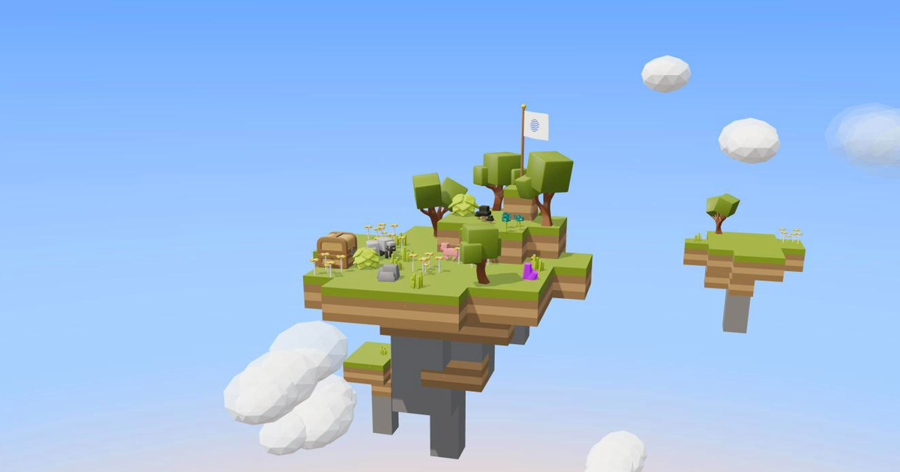
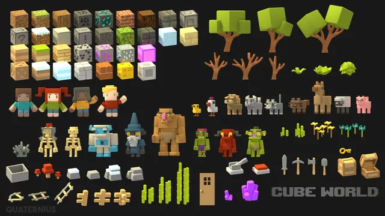
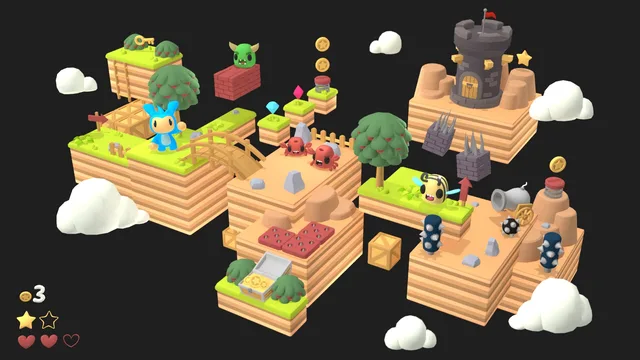
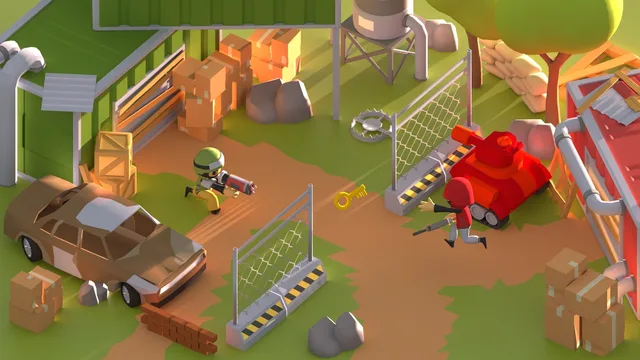
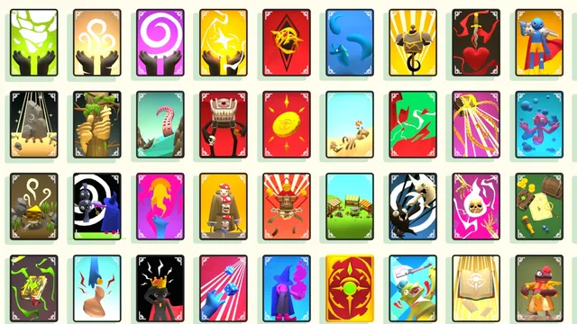
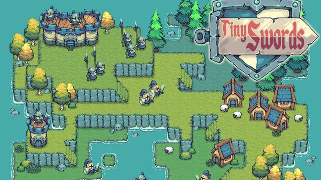
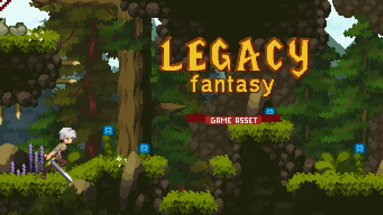
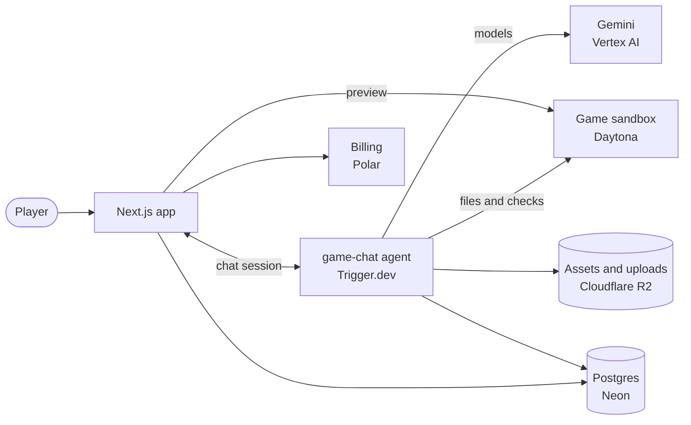

<div align="center">


# numa

**Describe your game. numa builds it.**

Tell an AI agent what you want to play and get a 2D or 3D game back, running in your browser.
<br />
If you can describe it, you can play it.

[](https://github.com/gorkadev/numa/actions/workflows/ci.yml)


<br />



</div>

## How it works

1. **Describe it.** One sentence is enough. Add references, and pick a template or start from a blank canvas.
2. **The agent builds it.** It plans the game, writes the code, sets the scene with real assets and checks that it runs.
3. **Play it and change it.** The game runs next to the chat. Ask for changes in plain words, or mention a file with `@` to point the agent at exactly what to touch.

## Templates

Each template brings a kit of real models and sprites, so the first version already has art direction.

<table>
  <tr>
    <td width="33%"><br /><b>Cube World</b> · 3D<br />A blocky world with heroes, animals and monsters.</td>
    <td width="33%"><br /><b>Platformer</b> · 3D<br />Bright platforms, coins and enemies to jump on.</td>
    <td width="33%"><br /><b>Toon Shooter</b> · 3D<br />Cartoon soldiers, weapons and battlefields.</td>
  </tr>
  <tr>
    <td width="33%"><br /><b>Fantasy Cards</b> · 3D<br />Fantasy cards of spells, creatures and treasures.</td>
    <td width="33%"><br /><b>Tiny Swords</b> · 2D<br />A pixel-art kingdom seen from above.</td>
    <td width="33%"><br /><b>Legacy Fantasy</b> · 2D<br />A pixel-art forest adventure seen from the side.</td>
  </tr>
</table>

Templates live in [`apps/web/lib/games/templates`](apps/web/lib/games/templates). A template declares its dimension, which picks the engine, instructions and skills the agent gets.

## Under the hood

A turn is a durable Trigger.dev run, not a request. The browser talks to the agent directly and can reconnect to a build that is still streaming.



Each game owns one chat and one sandbox. Bigger requests run as a phased flow (understand, plan, build, verify), with the orchestrator handing work to specialists:

| Agent | Role | Model slot |
| --- | --- | --- |
| Scout | Explores the game before anything changes | light |
| Architect | Writes the plan | strong |
| Builder | Gameplay | mid |
| Artist | Visuals | mid |
| Composer | Audio | light |
| Tester | Verifies that the game runs | strong |

Players choose a tier per turn (**Pro**, **Balanced** or **Fast**), and the tier decides which model fills each slot. One credit is one cent of what a turn actually costs to generate, and a turn that fails costs nothing.

## Stack

| Area | Tools |
| --- | --- |
| App | Next.js 16, React 19, Tailwind CSS, shadcn/ui, next-intl (English and Spanish) |
| Landing | Astro, React islands, three.js, GSAP |
| Agent | AI SDK 7, Trigger.dev `chat.agent`, Gemini on Google Vertex AI |
| Games | three.js, in Daytona sandboxes |
| Data | Neon Postgres, Drizzle ORM, Cloudflare R2 |
| Accounts and billing | Better Auth, Polar |
| Tooling | pnpm workspaces, Turborepo, GitHub Actions |

## Repository

```text
apps/
  web/        The product: chat, game preview, agent, billing
    lib/ai/       Model tiers, registry and pricing
    lib/games/    Harness, templates, tools and instructions
    trigger/      The Trigger.dev tasks, including game-chat
  landing/    The public site (Astro)
packages/
  db/         Drizzle schema and Neon policy
  ui/         Shared shadcn/ui components
  eslint-config, typescript-config
docs/         Research and backlog
odd/tasks/    Feature documents: specs, tasks and decision logs
```

## Run it locally

You need Node 20 or later, pnpm 10, and accounts for Neon, Trigger.dev, Daytona, Google Vertex AI, Cloudflare R2 and Polar.

```bash
pnpm install

# Add the variables below to apps/web/.env.local, then push the schema
pnpm db:push

# Web app on :3000, landing on :4321
pnpm dev

# In a second terminal: the agent worker
pnpm trigger:dev
```

> [!IMPORTANT]
> Always start the worker with `pnpm trigger:dev`. Running `trigger dev` directly breaks game creation.

<details>
<summary><b>Environment variables</b></summary>

| Service | Variables |
| --- | --- |
| Neon | `DATABASE_URL`, `DATABASE_URL_UNPOOLED`, `NEON_BRANCH` |
| Better Auth | `BETTER_AUTH_SECRET`, `BETTER_AUTH_URL` |
| OAuth | `GOOGLE_CLIENT_ID`, `GOOGLE_CLIENT_SECRET`, `GITHUB_CLIENT_ID`, `GITHUB_CLIENT_SECRET` |
| Trigger.dev | `TRIGGER_SECRET_KEY` |
| Google Vertex AI | `GOOGLE_VERTEX_PROJECT` |
| Daytona | `DAYTONA_API_KEY`, `DAYTONA_GAME_SNAPSHOT` |
| Cloudflare R2 | `R2_ACCOUNT_ID`, `R2_ACCESS_KEY_ID`, `R2_SECRET_ACCESS_KEY`, `R2_UPLOADS_BUCKET`, `TEMPLATE_ASSETS_URL` |
| Polar | `POLAR_ACCESS_TOKEN`, `POLAR_WEBHOOK_SECRET`, `POLAR_SERVER`, `POLAR_PRODUCT_FREE_ID`, `POLAR_PRODUCT_PRO_ID`, `POLAR_PRODUCT_MAX_ID`, `POLAR_METER_ID` |
| Previews | `PREVIEW_TOKEN_SECRET` |

Root scripts run through `neon-env`, which supplies the database variables. Build the Daytona snapshot once with `pnpm --filter web snapshot:build`. Billing setup is in [POLAR_SETUP.md](POLAR_SETUP.md).

</details>

## Development

| Task | Command |
| --- | --- |
| Lint | `pnpm lint` |
| Typecheck | `pnpm --filter web exec next typegen && pnpm typecheck` |
| Format | `pnpm format` |
| Inspect the database | `pnpm db:studio` |
| Sync template assets | `pnpm --filter web template-assets push <template>` or `pull` |

Run tests from `apps/web`, the way CI does. Running them from the repository root fails spuriously.

```bash
cd apps/web
pnpm exec tsx --test $(find . -name "*.test.ts*" -not -path "./node_modules/*" -not -path "./.next/*" -not -path "./.trigger/*")
```

Schema changes go through `packages/db/src/schema.ts` and `pnpm db:push`. There are no migration files during this phase; [AGENTS.md](AGENTS.md) explains why and when that changes.

## Status

numa is in active development. Billing runs against Polar's sandbox, so nothing takes real money yet.

## Credits

Template art comes from [Pixel Frog](https://pixelfrog-assets.itch.io/) (Tiny Swords), [Anokolisa](https://anokolisa.itch.io/) (Legacy Fantasy) and [Quaternius](https://quaternius.com/) (Platformer, Fantasy Cards).
